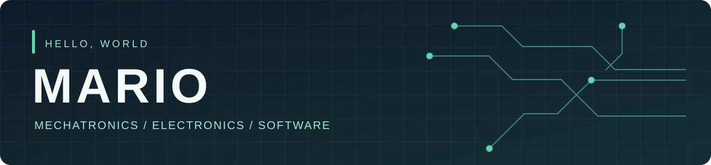

<p align="center">
  
</p>

# Hi, I'm Mario 👋

I'm a mechatronics student in Austria who likes making hardware and software work together. I'm especially interested in **embedded systems**, **robotics**, **self-hosting** and **medical engineering**.

> Build it. Test it. Learn from it. Make it better.

## On my workbench

**[EVSE-Control](https://github.com/MarioL-Tech/EVSE-Control)** — my diploma project: a system for monitoring an EV charging station with a Raspberry Pi, ESP32 and RFID. It currently reads wallbox data and has a read-only web view; actual charging control is still in development.

```text
ESP32 + RFID ── UART ──┐
                       Raspberry Pi ── MQTT → web view + data storage
EV charger ── Modbus ──┘           (read-only monitoring)
```

## Things I enjoy working with

`Microcontrollers` · `C++` · `Linux / NixOS` · `Docker` · `Electronics` · `CAD`

<p align="center">
  <sub>Mechatronics is fun until it isn't. Then it's a debugging session.</sub>
</p>
